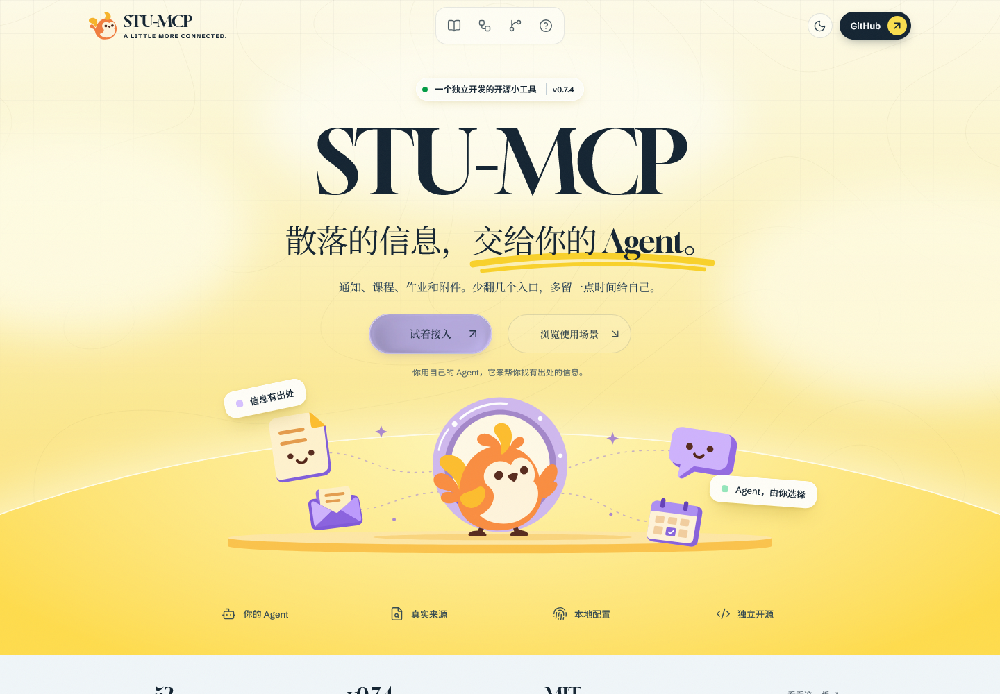

# STU MCP · 项目网站

把散在校园网站里的通知、课表和作业，交给你平时就在用的 AI Agent 查。这个网站用几个汕大校园场景，演示 STU MCP 能回答什么、信息从哪里来，以及怎样接到自己的 Agent 上。

[访问网站](https://stu-mcp.com/) · [STU MCP 工具仓库](https://github.com/0error0warning/stu-mcp)



## 网站做了什么

- **校园场景**：用「最近有哪些竞赛」「把接下来两周的作业按截止时间排一下」等问题展示用法，示例可以直接复制。
- **安装提示词**：可编辑内容、选择 Agent 和模型偏好，再复制给自己的 Agent。网页不会运行安装命令、调用模型或登录校园账号。
- **开发动态**：用近 90 天的提交热力图展示 `stu-mcp` 公共默认分支的变更；数据刷新失败时保留最近可用记录，不把缺失数据画成零。

这里是介绍网站，不是 MCP 服务本体。实际功能、安装方式和校园账号授权说明，以 [STU MCP 工具仓库](https://github.com/0error0warning/stu-mcp) 为准。

## 设计与实现

页面从 Side Quest Adoption Center 的纸质插画风格出发，为 STU MCP 重做了校园插画、场景和安装交互。页面主体使用 HTML、CSS 和 JavaScript，由 Vite 构建，部分交互动效使用 React；深浅主题都有独立视觉处理，并为减少动态效果的设置提供静态替代。

更多细节见[设计与实现](docs/implementation.md)、[浏览器验证](docs/qa.md)和[热力图数据口径](docs/activity-data.md)。

## 本地预览

使用 Node.js 22（与 CI 一致）：

```sh
npm ci
npm run dev
```

打开终端给出的本地地址。构建并预览生产产物：

```sh
npm run build
npm run preview
```

开发与本地预览提供只读的 `/api/activity`。只托管静态 `dist/` 时，未配置该接口会使用仓库内的提交快照，可通过 `npm run update:activity` 刷新。

## 第三方组件

组件和素材遵循各自的授权条款，详见[第三方声明](THIRD_PARTY_NOTICES.md)。STU MCP 工具仓库的 MIT 许可不自动适用于本站包含的第三方代码；本站不是可重新分发的模板或组件库。
